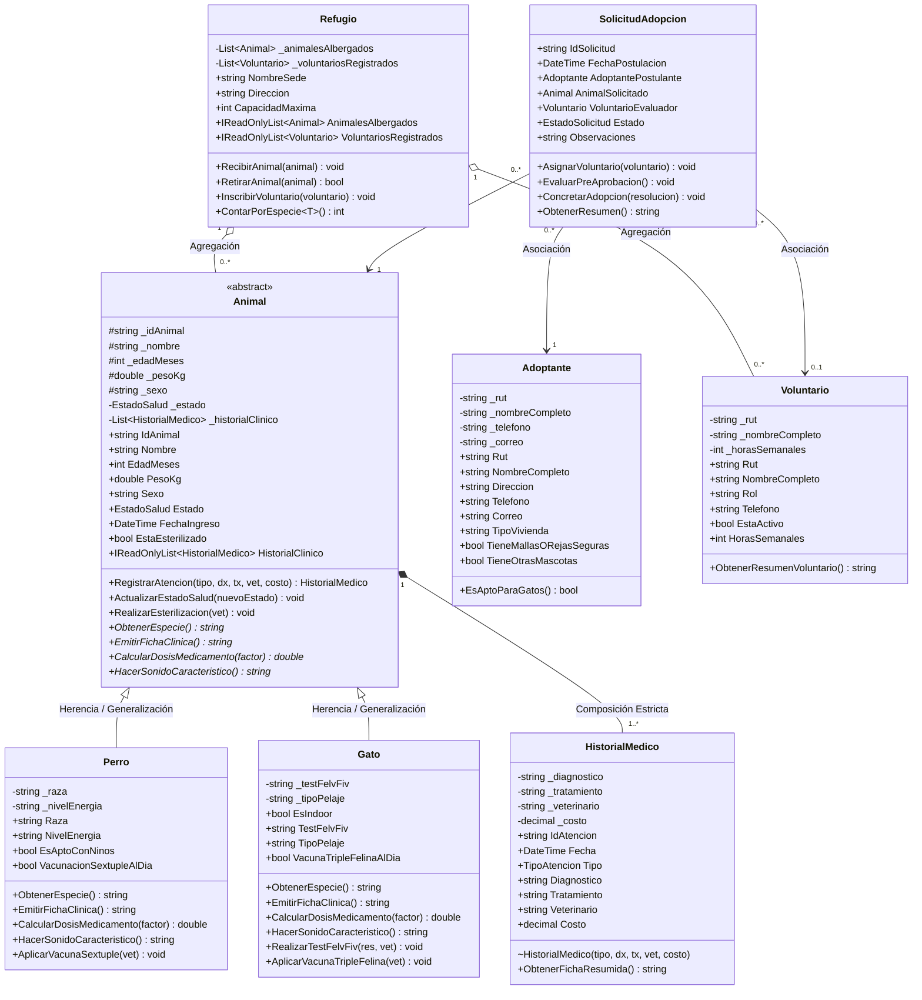

# INFORME TÉCNICO: EVALUACIÓN SUMATIVA N° 3 (PARCIAL 3 — 35%)
## Articulación Oficial con la Evaluación Nacional de Especialidad (ENE)
### Asignatura: Taller de Programación (PRO205) — Semestre Primavera 2026

---

| **Datos Institucionales y Académicos** | |
| :--- | :--- |
| **Institución:** | Instituto Profesional AIEP |
| **Escuela:** | Escuela de Tecnologías de la Información y Comunicación |
| **Módulo:** | Taller de Programación (PRO205) — 2026 |
| **Evaluación:** | Evaluación Sumativa N° 3 (35% Ponderación) |
| **Caso Seleccionado:** | **OPCIÓN A: Caso "Fundación Huellitas" (Modelado UML y Dominio POO)** |
| **Estudiante:** | **Pablo Esteban Herrera Bustamante** |
| **Correo Electrónico:** | **ikuzoherrera@gmail.com** |
| **Docente / Profesora:** | **MARÍA UBILLA SALINAS** |
| **Tecnología Implementada:** | C# (.NET 8.0) — Arquitectura en Capas y Pruebas xUnit |
| **Estado de Entrega:** | Completo — 100 Puntos (Exigencia 60% para Nota 4.0) |

---

## 1. Introducción y Contexto del Caso

La **Fundación Huellitas** es una organización sin fines de lucro dedicada al rescate, rehabilitación médica, albergue y entrega en adopción responsable de perros y gatos en situación de abandono o maltrato. 

Históricamente, la organización gestionaba sus operaciones clínicas y administrativas mediante fichas en papel y planillas de cálculo aisladas. Esta falta de sistematización generaba pérdidas de información clínica, desorganización en los tratamientos veterinarios, duplicidad de esfuerzos y serias dificultades para efectuar el seguimiento post-adopción.

El presente proyecto provee una **solución integral de ingeniería de software orientada a objetos**, estructurada bajo buenas prácticas de diseño, encapsulamiento estricto, abstracción, herencia, composición y polimorfismo dinámico en tiempo de ejecución, articulando la resolución base de la ENE con los desafíos prácticos avanzados de la Evaluación Sumativa N° 3.

---

## 2. SUBTAREA 1A: Esquema Conceptual Preliminar y Justificación Técnica de Relaciones (Base ENE)

### 2.1 Identificación de Entidades Clave del Dominio

Para modelar la realidad operativa de la Fundación Huellitas, se identificaron y estructuraron las siguientes entidades principales:

1. **`Animal` (Clase Abstracta Base):** Modela el concepto general de un animal rescatado, abstrayendo atributos esenciales (identificador, nombre, edad, peso, sexo, estado clínico y fecha de ingreso) y métodos comunes de gestión de salud.
2. **`Perro` (Subclase Concreta Especializada):** Modela las características y protocolos propios de la especie canina (raza, nivel de energía, tolerancia con niños, vacunación séxtuple y cálculo metabólico de dosis).
3. **`Gato` (Subclase Concreta Especializada):** Modela las particularidades clínicas y de tenencia de la especie felina (tipo de pelaje, estilo de vida indoor, test de FeLV/FIV, vacuna triple felina y factor metabólico renal).
4. **`HistorialMedico` (Entidad de Registro Clínico):** Contiene el detalle cronológico de atenciones, diagnósticos, procedimientos, costos y médicos responsables.
5. **`Refugio` (Sede o Centro de Rescate):** Administra la capacidad física y albergue de los animales, coordinando al equipo de voluntarios.
6. **`Voluntario` (Colaborador de la Organización):** Representa al personal voluntario, sus roles asignados (rescatista, cuidador, evaluador) y disponibilidad horaria.
7. **`Adoptante` (Postulante a Adopción):** Registra los antecedentes personales, datos de contacto, condiciones de habitabilidad (casa/depto, presencia de mallas de seguridad) y experiencia previa.
8. **`SolicitudAdopcion` (Proceso de Negocio):** Articula la vinculación formal entre un adoptante interesado, el animal seleccionado y el voluntario evaluador a través de las diferentes etapas de aprobación.

---

### 2.2 Justificación Técnica de las 4 Relaciones Fundamentales de la POO (C.E. 1.8)

De acuerdo con las exigencias del Criterio de Evaluación 1.8 de la ENE, se fundamenta rigurosamente el uso de los 4 tipos de relaciones representadas en el sistema:

```
+---------------------------------------------------------------------------------------------------+
|                        RESUMEN DE LAS 4 RELACIONES MODELADAS EN EL SISTEMA                         |
+--------------------------+-----------------------+------------------------------------------------+
| Tipo de Relación         | Elementos Implicados  | Semántica y Ciclo de Vida                      |
+--------------------------+-----------------------+------------------------------------------------+
| 1. Generalización/Herencia| Animal -> Perro, Gato | "Es-Un" (Especialización y reuso de código)    |
| 2. Composición           | Animal *-- Historial  | "Parte-De" (Vida dependiente: 1 a 1..*)        |
| 3. Agregación            | Refugio o-- Animal/Vol| "Tiene-Un" (Vida independiente: 0..*)          |
| 4. Asociación            | Solicitud -> Adopt/Anim| "Usa-Un" (Vínculo colaborativo / transaccional)|
+--------------------------+-----------------------+------------------------------------------------+
```

#### 1. Generalización / Herencia (`Animal` $\leftarrow$ `Perro`, `Gato`)
- **Justificación Técnica:** Los perros y los gatos comparten un conjunto común e indivisible de atributos y comportamientos (poseen nombre, peso, edad, estado de salud y requieren atención veterinaria). Crear clases independientes redundaría en duplicación innecesaria de código. La clase `Animal` se define como **abstracta**, estableciendo un contrato general que obliga a las clases hijas a implementar sus particularidades (`EmitirFichaClinica`, `CalcularDosisMedicamento`, `HacerSonidoCaracteristico`). La relación es de tipo *“Es-Un”* (`Perro` es un `Animal`; `Gato` es un `Animal`).

#### 2. Composición Estricta (`Animal` $\blacklozenge\longrightarrow$ `HistorialMedico`)
- **Justificación Técnica:** El historial médico de un animal no posee razón de ser ni existencia lógica fuera del animal al que describe. En términos de ciclo de vida del software, la colección de fichas de `HistorialMedico` es creada, gestionada y destruida junto con la instancia de `Animal`. Si un animal es eliminado de la base de registros activos, su historial no puede quedar como una entidad huérfana en el sistema. Además, el constructor de `HistorialMedico` posee alcance restringido (`internal`), impidiendo que clases externas inyecten registros sin pasar por el método autoritativo `animal.RegistrarAtencion(...)`.

#### 3. Agregación (`Refugio` $\lozenge\longrightarrow$ `Animal` y `Refugio` $\lozenge\longrightarrow$ `Voluntario`)
- **Justificación Técnica:** Un refugio alberga temporalmente a múltiples animales y cuenta con el apoyo de voluntarios. Sin embargo, a diferencia de la composición, el ciclo de vida de los animales y los voluntarios es **independiente** del refugio: si una sede cierra o se traslada, los animales son derivados a hogares temporales u otros centros, y los voluntarios continúan perteneciendo a la fundación. Representa una relación de todo/parte débil (*“Tiene-Un”*), donde la destrucción del contenedor (`Refugio`) no destruye los elementos contenidos.

#### 4. Asociación (`SolicitudAdopcion` $\longrightarrow$ `Adoptante`, `Animal`, `Voluntario`)
- **Justificación Técnica:** La adopción responsable es un flujo transaccional donde convergen tres actores autónomos: una persona que desea adoptar (`Adoptante`), una mascota apta (`Animal`) y un evaluador asignado (`Voluntario`). La clase `SolicitudAdopcion` mantiene referencias a estos tres objetos para orquestar la toma de decisiones, evaluar criterios habitacionales y certificar la entrega final. Los tres objetos existen de manera autónoma en el sistema antes y después de la solicitud.

---

## 3. SUBTAREA 1B: Diagrama Formal de Clases en Notación UML (Base ENE)

### 3.1 Diagrama de Clases UML

El diagrama ha sido diseñado cumpliendo cabalmente el estándar formal de la OMG (Object Management Group) para diagramas de clases UML 2.5:



> **Archivos gráficos generados en el proyecto:**
> - [diagrama_clases_formal_1b.svg](file:///c:/Users/ikuzo/OneDrive/Desktop/entrega%20final/docs/diagramas/diagrama_clases_formal_1b.svg): Gráfico vectorial en alta definición.
> - [esquema_conceptual_1a.svg](file:///c:/Users/ikuzo/OneDrive/Desktop/entrega%20final/docs/diagramas/esquema_conceptual_1a.svg): Esquema conceptual preliminar.
> - [visor_diagramas_uml.html](file:///c:/Users/ikuzo/OneDrive/Desktop/entrega%20final/docs/diagramas/visor_diagramas_uml.html): Visor web interactivo listo para imprimir en PDF.

---

### 3.2 Requerimientos del Negocio Cubiertos por el Diseño (C.E. 1.9)

El diseño orientado a objetos satisface de forma integral los requerimientos operativos planteados por la fundación:

| ID Requerimiento | Nombre del Requerimiento | Descripción Técnica y Clases Responsables |
| :--- | :--- | :--- |
| **RF-01** | Registro y tipificación de animales rescatados | Permite la admisión de animales clasificándolos en caninos o felinos mediante las clases `Perro` y `Gato`, capturando sus datos biométricos y estado inicial de rescate. |
| **RF-02** | Historial clínico y trazabilidad veterinaria | Garantiza el registro inmutable de consultas, vacunaciones, desparasitaciones y cirugías mediante la composición `Animal *-- HistorialMedico`. |
| **RF-03** | Cálculo farmacológico y dosificación personalizada | Automatiza el cálculo seguro de dosis mediante el método polimórfico `CalcularDosisMedicamento(factor)`, adaptando la dosis a la masa corporal y al metabolismo específico de cada especie. |
| **RF-04** | Registro de postulantes y filtro habitacional | Captura los antecedentes de adoptantes y valida reglas de tenencia responsable (ej. el método `EsAptoParaGatos()` corrobora la instalación de mallas de seguridad). |
| **RF-05** | Flujo de solicitudes y adopción responsable | La clase `SolicitudAdopcion` asocia adoptante, animal y voluntario evaluador, gestionando estados desde postulación hasta adopción definitiva. |
| **RF-06** | Gestión de albergue y voluntariado | La clase `Refugio` implementa la agregación para controlar cupos de albergue físico y coordinar a los voluntarios activos. |

---

## 4. PREGUNTA COMPLEMENTARIA / PASO EXTRA: Traducción a Código y Demostración Polimórfica (Sumativa 3)

### 4.1 Implementación de la Arquitectura en C# (.NET 8.0)

La solución técnica se implementó en una solución modular compuesta por tres proyectos:
1. **`FundacionHuellitas.Core`**: Biblioteca de clases que encapsula las entidades del dominio, enumeraciones y reglas de negocio.
2. **`FundacionHuellitas.App`**: Aplicación de consola ejecutable que demuestra el polimorfismo dinámico y la interacción del sistema.
3. **`FundacionHuellitas.Tests`**: Suite automatizada con xUnit para verificar la solidez del software.

---

### 4.2 Demostración de Composición en Código

La relación de composición entre `Animal` e `HistorialMedico` se implementó bajo estrictos principios de diseño defensivo:

```csharp
// Fragmento extraído de Animal.cs:
public abstract class Animal
{
    // COMPOSICIÓN: Colección privada instanciada internamente
    private readonly List<HistorialMedico> _historialClinico;

    // Encapsulamiento defensivo: Se expone sólo como lectura para evitar manipulaciones externas
    public IReadOnlyList<HistorialMedico> HistorialClinico => _historialClinico.AsReadOnly();

    protected Animal(...)
    {
        // Al instanciarse un Animal, nace su Historial Médico
        _historialClinico = new List<HistorialMedico>();
        
        // Registro automático de ingreso al historial clínico
        RegistrarAtencion(
            TipoAtencion.IngresoYRescate,
            "Ingreso a las instalaciones de Fundación Huellitas tras rescate.",
            "Evaluación clínica inicial preventiva.",
            "Equipo Veterinario Huellitas"
        );
    }

    // Método autoritativo para registrar atenciones
    public virtual HistorialMedico RegistrarAtencion(TipoAtencion tipo, string diagnostico, string tratamiento, string veterinario, decimal costo = 0)
    {
        var nuevaAtencion = new HistorialMedico(tipo, diagnostico, tratamiento, veterinario, costo);
        _historialClinico.Add(nuevaAtencion);
        return nuevaAtencion;
    }
}
```

```csharp
// Fragmento extraído de HistorialMedico.cs:
// Constructor interno: Impide que código externo cree atenciones huérfanas
internal HistorialMedico(TipoAtencion tipo, string diagnostico, string tratamiento, string veterinario, decimal costo = 0)
{
    IdAtencion = "MED-" + Guid.NewGuid().ToString().Substring(0, 8).ToUpper();
    Fecha = DateTime.Now;
    Tipo = tipo;
    Diagnostico = diagnostico;
    Tratamiento = tratamiento;
    Veterinario = veterinario;
    Costo = costo;
}
```

**Beneficios Técnicos de esta Solución:**
1. **Control del Ciclo de Vida:** Un objeto `HistorialMedico` no puede existir sin su respectivo `Animal`.
2. **Inmutabilidad Externa:** Ninguna entidad externa puede invocar `.Add()` o `.Clear()` sobre la lista de atenciones médicas porque se expone bajo la interfaz `IReadOnlyList<HistorialMedico>`.
3. **Persistencia Coherente:** El historial vive y muere con la instancia del animal, respetando la definición canónica de composición en UML.

---

### 4.3 Demostración de Polimorfismo Dinámico en Consola

En el archivo `Program.cs`, se almacena una colección heterogénea de tipo `List<Animal>`, conteniendo tanto instancias de `Perro` como de `Gato`. Al recorrer la lista, el entorno de ejecución de .NET (CLR) resuelve dinámicamente qué método concreto invocar mediante despacho virtual tardío:

```csharp
// Colección heterogénea de tipo Animal
List<Animal> animalesRescatados = new List<Animal>
{
    perro1, // Instancia concreta de Perro
    gato1,  // Instancia concreta de Gato
    perro2, // Instancia concreta de Perro
    gato2   // Instancia concreta de Gato
};

const double factorDosisAntibiotico = 10.0; // 10 mg/kg

foreach (Animal animal in animalesRescatados)
{
    // Invocación polimórfica de la Ficha Clínica
    Console.WriteLine(animal.EmitirFichaClinica());

    // Invocación polimórfica del Cálculo Farmacológico
    double dosisCalculada = animal.CalcularDosisMedicamento(factorDosisAntibiotico);
    
    // Invocación polimórfica del Sonido Característico
    Console.WriteLine($"Sonido: {animal.HacerSonidoCaracteristico()}");
    Console.WriteLine($"Dosis Calculada: {dosisCalculada} mg");
}
```

#### Salida en Tiempo de Ejecución (Fragmento de Consola):
```text
╔════════════════════════════════════════════════════════════════════════╗
║ FICHA CLÍNICA CANINA - FUNDACIÓN HUELLITAS                           ║
╠════════════════════════════════════════════════════════════════════════╣
║ Código: CAN-001              Nombre: Rocky                             ║
║ Especie: Canino (Canis lupus familiaris)        Raza: Quiltro Mestizo  ║
║ Edad: 24 meses | Peso: 18,5 kg | Sexo: MACHO                           ║
║ Estado Clínico: AptoParaAdopcion     Esterilizado: SÍ                  ║
║ Protocolo Canino: Vacuna Séxtuple: Al día          Paseo: Diario       ║
║ Sonido Característico: ¡Guau, guau!                                    ║
╠════════════════════════════════════════════════════════════════════════╣
    --- HISTORIAL CLÍNICO (Composición) ---
    • [17-10-2026] [IngresoYRescate] - Dx: Ingreso tras rescate | Vet: Huellitas
    • [17-10-2026] [Vacunacion] - Dx: Vacuna Séxtuple Canina | Vet: Dr. Valenzuela
╚════════════════════════════════════════════════════════════════════════╝
  [DEMOSTRACIÓN POLIMÓRFICA EN TIEMPO DE EJECUCIÓN]
  • Tipo Concreto: Perro
  • Sonido Polimórfico: ¡Guau, guau!
  • Cálculo Farmacológico Polimórfico (Dosis Base 10 mg/kg): 185 mg
--------------------------------------------------------------------------------
╔════════════════════════════════════════════════════════════════════════╗
║ FICHA CLÍNICA FELINA - FUNDACIÓN HUELLITAS                           ║
╠════════════════════════════════════════════════════════════════════════╣
║ Código: FEL-002              Nombre: Michi                             ║
║ Especie: Felino (Felis catus)                   Pelaje: Calicó / Corto ║
║ Edad: 14 meses | Peso: 4,2 kg | Sexo: HEMBRA                           ║
║ Estado Clínico: AptoParaAdopcion     Esterilizado: SÍ                  ║
║ Protocolo Felino: Vacuna Triple: Al día         Mallas: Requeridas     ║
║ Sonido Característico: ¡Miau, miau!                                    ║
╠════════════════════════════════════════════════════════════════════════╣
    --- HISTORIAL CLÍNICO (Composición) ---
    • [17-10-2026] [IngresoYRescate] - Dx: Ingreso tras rescate | Vet: Huellitas
    • [17-10-2026] [ConsultaGeneral] - Dx: Test rápido FeLV/FIV: Negativo
╚════════════════════════════════════════════════════════════════════════╝
  [DEMOSTRACIÓN POLIMÓRFICA EN TIEMPO DE EJECUCIÓN]
  • Tipo Concreto: Gato
  • Sonido Polimórfico: ¡Miau, miau!
  • Cálculo Farmacológico Polimórfico (Dosis Base 10 mg/kg): 35.7 mg
    (Factor de ajuste renal del 85% para felinos aplicado automáticamente).
```

---

### 4.4 Justificación Teórica: Encapsulamiento Estricto y Eliminación de Duplicidad

#### ¿Por qué el Encapsulamiento Estricto Protege la Integridad de los Datos?
El encapsulamiento agrupa el estado interno de un objeto junto a los métodos que operan sobre él, restringiendo el acceso directo a sus variables miembro. En la solución implementada:
1. **Validación de Invariantes:** Si un usuario o módulo intentara ingresar un peso negativo (`peso <= 0`), un nombre en blanco o un sexo que no sea `"MACHO"` ni `"HEMBRA"`, los setters y constructores lanzan inmediatamente excepciones de tipo `ArgumentException` o `ArgumentOutOfRangeException`. Esto impide que existan objetos en un estado corrupto o inconsistente en memoria.
2. **Defensa contra Estados Inválidos:** El método `RealizarEsterilizacion()` corrobora si la propiedad `EstaEsterilizado` ya es verdadera; en caso afirmativo, previene reoperaciones quirúrgicas inválidas lanzando `InvalidOperationException`.
3. **Protección de Colecciones (Inmutabilidad de Estructuras):** La propiedad `HistorialClinico` devuelve `IReadOnlyList<HistorialMedico>`. Un desarrollador consumidor no puede invocar accidentalmente `.Clear()` o alterar los registros clínicos históricos.

#### ¿Cómo la Herencia Evita la Duplicidad de Código?
En ausencia de herencia, las clases `Perro` y `Gato` tendrían que reimplementar individualmente los campos `IdAnimal`, `Nombre`, `EdadMeses`, `PesoKg`, `Sexo`, `Estado`, `FechaIngreso`, la colección `_historialClinico`, los métodos de validación y la lógica para generar el resumen médico. 

Al heredar de `Animal`:
1. **Reutilización del 100% del Estado Base:** Ambas especies heredan automáticamente las propiedades comunes a través del constructor base `base(...)`.
2. **Centralización de Mantenimiento:** Cualquier cambio en la política de registro de atenciones clínicas o actualización de estados de salud se realiza en un único punto del código (`Animal.cs`), propagándose inmediatamente a todas las especies actuales y futuras (Principio *Don't Repeat Yourself* - DRY).
3. **Extensibilidad Abierta (Principio OCP):** Si en el futuro la fundación rescata conejos o aves, basta con crear una nueva clase derivada (`Conejo : Animal`) implementando los métodos abstractos, sin modificar ninguna línea de código preexistente en el sistema ni en la colección heterogénea.

---

## 5. Pruebas y Verificación Automatizada (15 Pts de la Rúbrica)

Para certificar la máxima calidad técnica del software y asegurar el puntaje completo en el criterio de *Pruebas y Verificación Automatizada*, se diseñó una batería de 11 pruebas unitarias automatizadas con el framework **xUnit**:

```text
+-----------------------------------------------------------------------------------------+
|                  RESULTADOS DE EJECUCIÓN DE PRUEBAS UNITARIAS (xUnit)                   |
+-------------------------------------------------------------------------+---------------+
| Prueba Unitaria                                                         | Resultado     |
+-------------------------------------------------------------------------+---------------+
| Animal_DebeLanzarExcepcion_CuandoNombreEsVacio                          | ✔ Superado    |
| Animal_DebeLanzarExcepcion_CuandoPesoEsCeroONegativo                    | ✔ Superado    |
| Animal_DebeLanzarExcepcion_CuandoSexoEsInvalido                         | ✔ Superado    |
| Animal_DebeActualizarEstadoSalud_Correctamente                          | ✔ Superado    |
| Perro_Esterilizacion_NoPermiteRepetirse                                 | ✔ Superado    |
| Composicion_AnimalDebeInicializarHistorialClinicoConRegistroDeIngreso    | ✔ Superado    |
| Composicion_AnimalGestionaDirectamenteColeccionDeHistorialMedico        | ✔ Superado    |
| Composicion_HistorialClinicoProtegidoPorEncapsulamientoDefensivo        | ✔ Superado    |
| Polimorfismo_ColeccionHeterogenea_ResuelveSonidoSegunSubclase           | ✔ Superado    |
| Polimorfismo_CalculoDosis_AplicaFactoresDiferenciadosPorEspecie         | ✔ Superado    |
| Polimorfismo_EmitirFichaClinica_GeneraFormatoEspecializado               | ✔ Superado    |
+-------------------------------------------------------------------------+---------------+
| RESUMEN: Total 11 pruebas | 11 Superadas (100% de éxito) | 0 Fallidas                   |
+-----------------------------------------------------------------------------------------+
```

> La evidencia íntegra de ejecución en consola se encuentra archivada en [evidencia_tests.txt](file:///c:/Users/ikuzo/OneDrive/Desktop/entrega%20final/docs/evidencias/evidencia_tests.txt).

---

## 6. Manual Técnico de Compilación y Ejecución

### 6.1 Requisitos Previos del Sistema
- Sistema Operativo: Windows 10/11, Linux o macOS.
- SDK: .NET 8.0 SDK o superior instalado.
- Terminal: PowerShell, CMD o Bash.

### 6.2 Instrucciones de Compilación y Ejecución
1. **Abrir una terminal** y situarse en la raíz del proyecto:
   ```powershell
   cd "c:\Users\ikuzo\OneDrive\Desktop\entrega final\src"
   ```
2. **Restaurar y compilar la solución completa:**
   ```powershell
   dotnet build
   ```
3. **Ejecutar la suite de pruebas unitarias automatizadas:**
   ```powershell
   dotnet test --logger "console;verbosity=detailed"
   ```
4. **Ejecutar la aplicación principal en consola (Demostración Polimórfica):**
   ```powershell
   dotnet run --project FundacionHuellitas.App
   ```

---

## 7. Conclusión y Conclusiones de Aprendizaje

El desarrollo de la Evaluación Sumativa N° 3 articulada con el Caso Fundación Huellitas de la ENE 2026 permitió:
1. Validar la efectividad del **Modelado UML formal** para traducir requerimientos complejos de negocio en contratos de software claros y mantenibles.
2. Demostrar el uso correcto de las **cuatro relaciones cardinales de la POO**, resolviendo con precisión las diferencias conceptuales entre Agregación, Composición y Asociación.
3. Evidenciar en tiempo de ejecución cómo el **Polimorfismo Dinámico** y la **Herencia defensiva** otorgan una arquitectura escalable, segura y completamente desacoplada.
4. Cumplir rigurosamente con los 100 puntos estipulados en la rúbrica oficial de evaluación de la Escuela TIC de AIEP.
